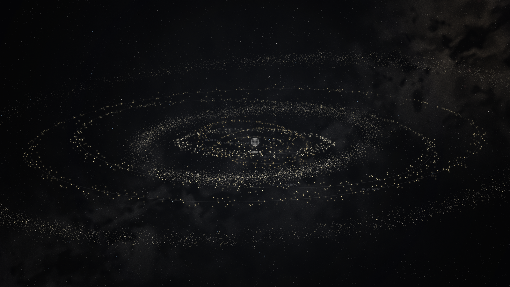
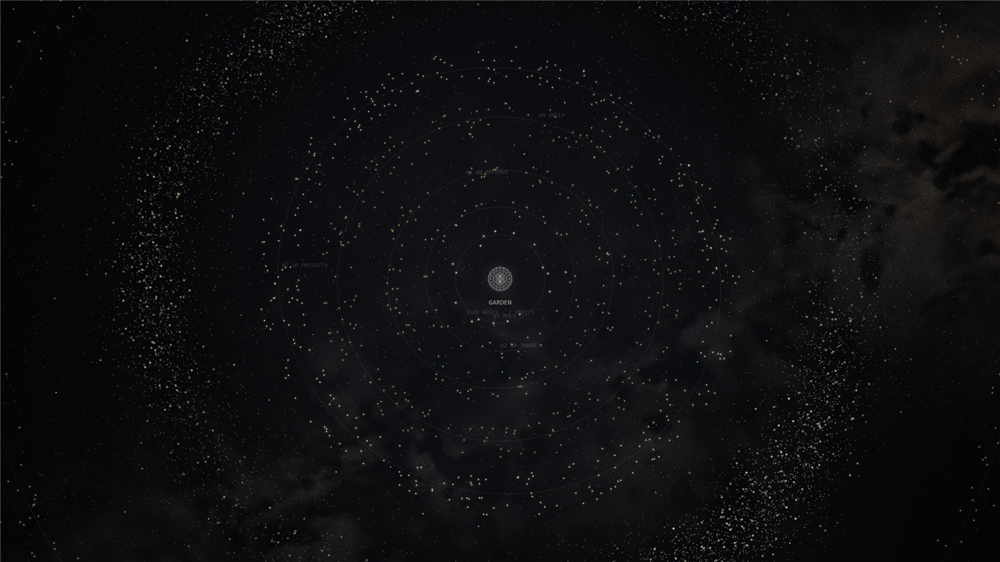

# Rho Network

Your Obsidian vault as a living 3D star system. Each top folder becomes an orbit, its notes the planets, and the links between notes the faint lines across the sky. It turns slowly, it reacts as you write, and now and then a star goes off.

## What you get

- **A star system of your vault.** A globe in the middle, one tilted orbit per top folder, a planet per note. Notes you open often shine brighter and show their names. Planets keep their distance, so none sit on top of each other. A soft glow and a faint dark rim round the whole system set it apart from the dark behind it.
- **Asteroid belts** for the crowded outer parts of big vaults, drawn on the graphics card (WebGL2) where there is one, so a vault of tens of thousands of notes stays smooth. The belts turn with the system and stay attached to it.
- **Link lines** between linked notes. The note under the mouse and the open one always show theirs.
- **Drill in.** Click an orbit's name to fly into it; breadcrumbs, the Back button or Backspace take you out again.
- **Group by** folders, tags or link clusters, or let Auto pick. Press G on the map to switch.
- **The note box.** Click a planet to read its note in a glass panel over the map, styled to match the map. The planet's ring eases to a stop while the others keep turning, and the map zooms out a little if the planet would sit under the box. Drag the box's edges to resize it. Turn on EDIT to write in it; the card column tucks itself away while you write, and its ‹ tucks it by hand. Drag the card column's right edge to make it wider or narrower (180 to 480 px); double-click the edge to reset it.
- **Search.** Press `/`, type, Enter flies you to the note. The ✕ in the box clears it. After three letters it also reads your notes and lists up to three that mention what you typed, each with the line it was said in and your words picked out; the arrow keys choose one and Enter goes there. It's for when you remember what a note said but not what it was called.
- **Open notes.** A note with unticked tasks (`- [ ]`) glows softly. The three you edited most recently (within 14 days) glow brighter, pulse a ring and sit in an Open notes strip under the top bar. Click one to open the note at its first open task. Hold its ✕ for about a second to drop it from the strip.
- **Due date notes.** Give a note a due date and it's listed bottom right, soonest first (the five soonest, then "+N more"), coloured by how close it is: rose for late, orange for today, amber for this week, pale gold for later. A date can be a property named `due`, `deadline`, `due-date`, `dueDate` or `due_date`, or sit on a task line as `📅 2026-11-03` or `[due:: 2026-11-03]`. If a note has several, the soonest unticked one counts. Ticking the task, or `done: true` / `status: done` in the properties, takes it off the list.
- **Tour.** Press A and the camera drifts through the system on its own; any key or click ends it. Set Tour when idle (1 to 10 minutes) and it starts by itself once that long has passed with no mouse or keys while another window is in front of Obsidian, like a screensaver.
- **Time-lapse.** Press T and watch your vault grow, note by note, in the order you made them.
- **Look mode.** Press O and everything but the sky goes away.
- **Widgets** in a side column: recent edits, activity, open tasks, inbox, on this day, most opened, vault stats, orphans and broken links, or any note, folder or tag you pin there.
- **The sky.** Supernovas now and then (rarely two at once), shooting stars, and a black hole that keeps the graveyard of notes you deleted (click it to see them).
- **Themes:** Deep space, Dusk, Ember and Paper (the light one). The search box and its suggestions, and the colour of the cursor and focus ring, follow the theme and the Planet colours. **Planet colours:** Sand, Black & white, Dusk (the dark one), Halloween, Age (by when each note was last edited) and Classic.

## Controls

| Key | What it does |
|---|---|
| Scroll | Zoom |
| Drag | Spin the system |
| Double-click | Back to the start view |
| Click a planet | Open its note in the note box |
| `/` | Search |
| G | Next grouping |
| A | Tour |
| O | Look mode |
| T | Time-lapse |
| Backspace | Out of an orbit |
| Esc | Close / stop |

Open it from the globe icon in the ribbon or the command palette ("Rho Network: Open").

## Settings

Settings > Rho Network, or the gear on the map itself. Both have two tabs, and both show the same settings.

- **General:** theme, planet colours, darkness, ambient glow, ring spacing and planet size (under Look); spin (under Motion); group by and folders to leave off the map (under Layout; pick them with + folder, take them back with their ✕).
- **Advanced:** dark rim, ring tilt, star density, glow and link lines (Look); tour when idle (Motion); supernovas and the black hole (Sky events); open notes and due date notes (Work); the second belt (Layout); quality, Balanced, High or Low (Performance).

Every slider has a reset. Ring spacing goes to 300%, spin to 400% and planet size down to 30%.

Updating keeps your settings as you left them. The one new default is the look of a new install: ambient glow and dark rim start at 100%. If you already had settings saved by 2.0.x, both stay at 0 until you move them.

## Pairs well with

**Rho Zero**, a dark theme in the same sand and charcoal. Settings > Appearance > Themes > Manage, search for Rho Zero.

## Install

In Obsidian: Settings > Community plugins > Browse, search for **Rho Network**, Install, then Enable.

Or by hand: from the latest release, download `main.js`, `manifest.json` and `styles.css` into `<your vault>/.obsidian/plugins/rho-network/`, then switch Rho Network on in Settings > Community plugins.

Desktop only.

## Privacy

Rho Network makes no network requests, has no telemetry and loads no code from anywhere else. Everything it does happens inside Obsidian, on your machine. The directory's review lists a few things it touches; this is what each one is for:

- **Your vault's files:** it reads the list of notes, their dates, their tasks and due dates, and Obsidian's link cache to draw the map and fill the widgets; the suggestions under the search box read the text of your notes. It writes to a note only when you type in the note box with EDIT on.
- **Local storage:** a little state of its own, kept per vault in Obsidian's local storage: how often notes are opened, the sky's stars and supernova remnants, the notes you dropped from the Open notes strip, when the next visitor passes through, whether the card column is tucked, and whether EDIT is on.
- **The black hole's graveyard:** the name, folder path and time of up to 2,000 notes you deleted (newest first, older ones drop off), kept in local storage on your machine so the graveyard can list them. The notes' text isn't kept.
- **The clipboard:** written to only when you click something marked to be copied. It never reads it.

It also keeps a spare copy of its settings in your vault's config folder, so an update that replaces the plugin folder doesn't lose them.

## Support

Rho Network is free to use. Bug reports and ideas are welcome in the [issues](https://github.com/clowsuzu/rho-network/issues). If it earns its place in your vault, you can [buy me a coffee](https://buymeacoffee.com/rhonetwork).

Built with AI assistance (Claude); designed, directed and tested by Clowsuzu.

## Licence

[PolyForm Strict 1.0.0](https://polyformproject.org/licenses/strict/1.0.0), see [LICENSE](LICENSE). Free to use for yourself and for any other noncommercial purpose. Selling it, passing copies on and publishing changed versions are not allowed.
